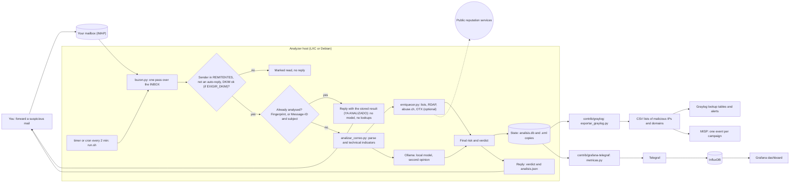
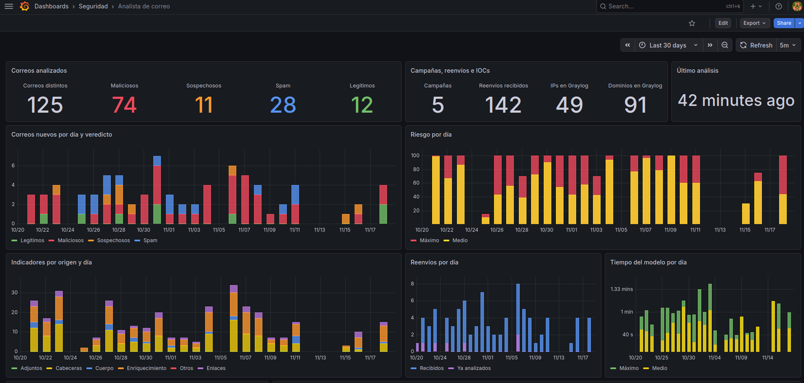
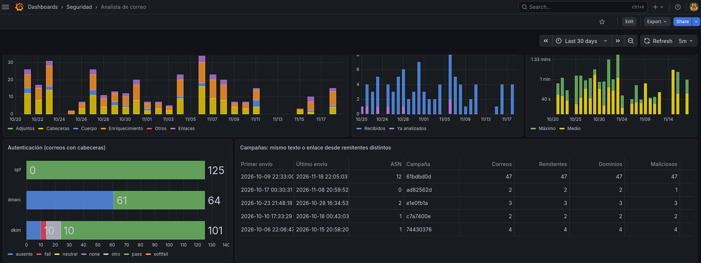

# suspicious-email-analyzer

**English** · [Castellano](README.md)

**Local analyzer for suspicious e-mails (phishing, fraud, malware, spam).** You forward a doubtful message to a
mailbox you own and get back a JSON risk assessment: deterministic technical indicators (SPF/DKIM/DMARC, links,
attachments inspected from the inside without executing anything) plus the opinion of a local model running on
[Ollama](https://ollama.com) (`qwen2.5:7b` by default). Nothing leaves your machine except the mail itself, which goes through your
provider, and the enrichment lookups to public reputation services, which you can turn off.

The program is called `analista-correo` in the code, the file names and the settings. The core is plain Python (standard library only, no third-party packages). The program's messages, rule names and JSON
fields are in Spanish; this README is the overview and the detailed documentation is in [`docs/`](#documentation).

## How the pieces fit



`despliegue/` builds the analyzer host (the container, Ollama, the model and the timer) in one command; everything right of the analyzer is optional.

## Quick start

Requirements: Python 3.11+, [Ollama](https://ollama.com) with a model (`ollama pull qwen2.5:7b`; `qwen2.5:3b` if memory
is tight, although its license (Qwen Research) only allows research or evaluation: the 7b and 14b are Apache-2.0; with more capacity, a larger one via `ANALISTA_CORREO_MODELO=qwen2.5:14b` or `--modelo` in `analizar_correo.py`),
`dig` (package `dnsutils`/`bind-utils`, for the rDNS lookups of the enrichment) and, for `pruebas/probar.sh`, `jq`. For
mailbox mode, a mail account with IMAP and SMTP.

```
git clone https://github.com/k4y53r/suspicious-email-analyzer.git && cd suspicious-email-analyzer
python3 analizar_correo.py pruebas/sinteticos/malware-adjunto.eml      # one analysis, no mailbox
python3 -I pruebas/probar_reglas.py                                    # tests, no model and no network
```

For mailbox mode:

```
mkdir -p ~/.config/analista-correo && cp buzon.env.example ~/.config/analista-correo/buzon.env
chmod 600 ~/.config/analista-correo/buzon.env      # then edit it: server, user, MX_BUZON, REMITENTES
ANALISTA_CORREO_SIN_ENRIQUECER=1 python3 buzon.py --eml pruebas/sinteticos/legitimo-trabajo.eml   # no IMAP/SMTP, no external services: prints the reply it would send (the local model is still needed)
```

**Automatic deployment** in a Proxmox LXC (or any Debian): [`despliegue/`](despliegue/README.en.md) (one command; you only provide your
`buzon.env` and, if you want, another Ollama model with `--modelo`). It installs Ollama with its official script, without hash verification, and copies the code without pinning a version: review what you are about to run as root. To do it by hand, schedule `run.sh` from cron or a
systemd timer (see [Mailbox mode](docs/mailbox-mode.en.md)). To forward from Thunderbird or Gmail, see [`guia-reenvio.en.md`](guia-reenvio.en.md). Optional extras
(exporting IOCs to Graylog, metrics for Grafana) are in `contrib/`.

## Privacy and limits

- The analyzer does not open links or run attachments. The text of the mail reaches the local model; the mail, the
  analyses and the replies are kept in `~/.local/state/analista-correo/` (directory 700, files 600).
- A 7B model gets things wrong: treat the verdict as a second opinion. Mails can try to manipulate the model (prompt
  injection); that is why hidden text and injection phrases score separately and the model cannot lower strong
  indicators.
- The enrichment lookups (abuse.ch, RDAP, OTX) send the IPs and domains of the mail to those services; RDAP goes
  straight to each TLD's registry (or to `rdap.org` if it does not answer). The public lists (Tor, Feodo, DROP, Tranco, IFIN,
  the IANA RDAP catalogue) are only downloaded: nothing from the mail is sent.
  In `analizar_correo.py` they only happen with `--enriquecer`; mailbox mode (`buzon.py`) always does them unless you set
  `ANALISTA_CORREO_SIN_ENRIQUECER=1` in the environment of `run.sh`/cron.
- Security: see `SECURITY.md`. License: AGPL-3.0-only (`LICENSE`), copyright © 2026 k4y53r: you may use, modify and share it, but modified versions (including ones offered as a network service) must be published under the same license.

## Third-party sources and attribution

The (optional) enrichment uses public services and lists with their own terms of use; read them before heavy use:
[abuse.ch](https://abuse.ch) (ThreatFox, URLhaus; a free Auth-Key is required), the [Tor](https://check.torproject.org/torbulkexitlist)
exit list, [Feodo Tracker](https://feodotracker.abuse.ch/), [Spamhaus DROP](https://www.spamhaus.org/drop/) (its own terms),
the [Tranco](https://tranco-list.eu) ranking (cite it if you publish results that use it), RDAP (public registries of
each RIR/registry, located through the [IANA](https://data.iana.org/rdap/) catalogue), the nine [IFIN lists](https://lists.ifin.network/) of abusable services (AGPL-3.0, context only) and, if you configure it, AlienVault OTX.

## Usage

```
python3 analizar_correo.py correo.eml
python3 analizar_correo.py --reenviado reenviado.eml
python3 analizar_correo.py --sin-modelo correo.eml
python3 analizar_correo.py --modelo qwen2.5:14b correo.eml
python3 analizar_correo.py --enriquecer correo.eml      # public lists, abuse.ch and RDAP (and OTX if configured)
```

No Python dependencies (the standard library is enough); you also need `dig`, `git` and Ollama. With the 7B model on CPU it takes about 15-55 s per mail with the model loaded and 40-75 s cold
(approx., measured on the author's machine: CPU, no GPU).

`pruebas/probar_reglas.py` (no model, no network, seconds) checks injection phrases, hidden and visible styles, HTML with
unclosed tags, real types and ZIP attachments; run it after touching `INYECCION`, `CSS_OCULTO`, `Texto`, `MAGIA`,
`mirar_ole` or the attachment rules.

`pruebas/probar.sh [model] [output.jsonl]` runs `pruebas/corpus.tsv` (labelled mails with the expected verdict) and flags
mismatches. The repository only contains the synthetic samples in `pruebas/sinteticos/` (`*.example` or invented
domains, no personal data); add your own mails to `corpus.tsv` keeping them **out of git**, because real ones contain
personal data. With a model it takes ~1 min per mail (`PAUSA` seconds of rest between them, 60 by default).

## Choosing a model

The model gives a second opinion; the deterministic indicators decide most verdicts. A comparison on the 23 synthetic
mails of `pruebas/corpus.tsv` (same code, only `--modelo` changes; enrichment on) gives a reference point:

| Model | Within the expected verdict | Model time per mail (median / max) | Whole corpus |
|---|---|---|---|
| `qwen2.5:7b` (default) | 23 / 23 | 64 s / 143 s | 28 min |
| `qwen2.5:14b` | 22 / 23 | 145 s / 298 s | 59 min |

Measured on a 6-core Xeon E5-2620 v1 (AVX only, DDR3-1067, no GPU) in a container with 10 vCPU and 28 GB of RAM; times
scale with your hardware, and a GPU changes them a lot.

- **Verdict and risk differed in 6 of 23 mails.** The 14b classifies better the mails the 7b called "legitimate" while
  they were malicious (hidden-text injection, macro and encrypted attachments, a bait mail), but the final verdict
  barely moved because the technical indicators already got them right.
- **The larger model is not automatically better.** The 14b was the only one to miss: it scored a bait mail without a
  link as malicious (65) where the 7b said suspicious (50), and the expected answer was anything below malicious.
- **It costs about 2.3 times the time and 2 times the memory** (the 14b needs ~9 GB of free RAM next to the system).
- This corpus is synthetic and made to exercise the rules, not to fool the model. Do not read it as a ranking: it is a
  starting point. To compare on your own mail, run `pruebas/probar.sh <model> out.jsonl` once per model and diff the
  results; keep your real corpus **out of git**. To switch: `--modelo` in `analizar_correo.py`, or
  `ANALISTA_CORREO_MODELO` (see `despliegue/README.en.md` for the timer).
- Rule of thumb: start with the default; try a larger one if you have memory to spare, mails where the text matters more
  than the headers, or a GPU; use `qwen2.5:3b` only when memory is tight and your use is research or evaluation (Qwen Research license, non-commercial; not measured here). The 7b and 14b are Apache-2.0.

## Using the output

The analyzer is built so its results can feed the tools you may already run. Every analysis leaves four kinds of output:
the `analisis.json` attached to each reply (verdict, risk, indicators and `iocs`), the SQLite database (`analisis.db`),
and two optional exports in `contrib/`: CSV lists of malicious IPs and domains, and InfluxDB line-protocol metrics.

| Goal | How | Where |
|---|---|---|
| Detect it on your network (Graylog or any SIEM) | The CSV lists (`correo_iocs_ip.csv`, `correo_iocs_dominio.csv`) are lookup tables: alert when a client of your LAN resolves or contacts an IP or domain that already arrived by mail. | `contrib/README.en.md`, "Exporting IOCs" |
| Dashboard (Grafana) | `metricas.py` writes InfluxDB line protocol and Telegraf ships it. Measurements: `correo_dia` (verdicts and mean risk per day), `correo_indicador` (what triggered: headers, body, attachments, URLs, enrichment), `correo_envios` (forwards and reused analyses), `correo_modelo` (model latency), `correo_autenticacion` (SPF/DKIM/DMARC results), `correo_total` and `correo_campana` (campaigns). An importable dashboard is in `contrib/grafana-telegraf/dashboard.json`. | `contrib/README.en.md`, "Metrics for Grafana" |
| Threat-intelligence platform (MISP) | Read the same CSV lists (or the `iocs` table) and create one MISP event per campaign, with the IPs and domains as attributes. A short PyMISP example is in `contrib/README.en.md`. | `contrib/README.en.md`, "MISP" |
| Block at the DNS (AdGuard Home, Pi-hole…) | Turn the domain CSV into a blocklist. Review it first: it is a sample of what reached your own mailbox, not a curated feed. | your DNS filter |
| Ad-hoc questions | The SQL queries of [Mailbox mode](docs/mailbox-mode.en.md#database-and-duplicates) (shared infrastructure by ASN, campaigns by root domain, template or kit). | `analisis.db` |


*The dashboard in `contrib/grafana-telegraf/dashboard.json`: totals by verdict, new mails per day, risk, indicators by origin, forwards and model latency. Real data from the author's mailbox; panel texts are in Spanish, like the program's output.*


*SPF/DKIM/DMARC results, and campaigns (the same text or hosting link sent from different senders).*

Things worth knowing before you automate on top of it:
- The CSV lists only carry malicious verdicts, drop shared infrastructure (webmail, shorteners, sending platforms), your
  own domains and the popular domains of the Tranco ranking, and cap the age of what they export (90 days for IPs, 180
  for domains). Even so they are one model's opinion on a few mails: keep a human in the loop before blocking.
- A shared-hosting link is an IOC as a full URL, not as a domain; the exporter already keeps that distinction.
- `info` in the CSV only holds your own data (risk, campaign, date, number of mails), never the subject or the text,
  because the attacker writes those.
- Give each integration its own credentials with the least privilege it needs (a Publisher-only MISP key, a write-only
  InfluxDB token) and keep them in files with mode 600, not on the command line.

## Documentation

The detail lives in `docs/` (each page has an English and a Castellano version):
- [How it works](docs/how-it-works.en.md): what the analyzer checks, how the score is built, how to forward a mail.
- [Mailbox mode](docs/mailbox-mode.en.md): `buzon.py`, configuration, the database, duplicates and useful SQL queries.
- [Enrichment](docs/enrichment.en.md): reputation lookups, weights, OTX, abuse.ch, Tranco.
- [Detection rules of 1.15](docs/detection-rules.en.md): the R1-R7 table and its limits.
- [Automatic deployment](despliegue/README.en.md), [optional extras](contrib/README.en.md), [security policy](SECURITY.md) and [forwarding guide](guia-reenvio.en.md).
