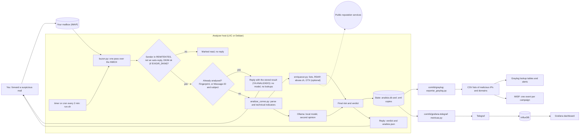
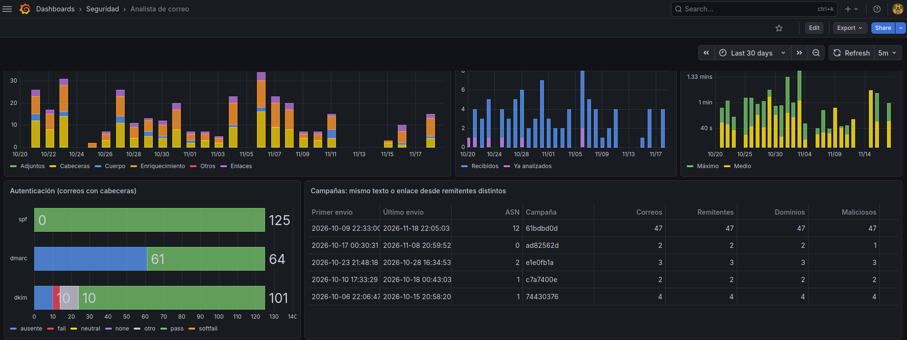

# analista-correo

**English** · [Castellano](README.es.md)

**Local analyzer for suspicious e-mails (phishing, fraud, malware, spam).** You forward a doubtful message to a
mailbox you own and get back a JSON risk assessment: deterministic technical indicators (SPF/DKIM/DMARC, links,
attachments inspected from the inside without executing anything) plus the opinion of a local model running on
[Ollama](https://ollama.com) (`qwen2.5:7b` by default). Nothing leaves your machine except the mail itself, which goes through your
provider, and the enrichment lookups to public reputation services, which you can turn off.

The core is plain Python (standard library only, no third-party packages). The program's messages, rule names and JSON
fields are in Spanish; this README is the English reference, and the detailed rule history lives in `README.es.md`.

## How the pieces fit



`contrib/despliegue/` builds the analyzer host (the container, Ollama, the model and the timer) in one command; everything right of the analyzer is optional.

## Quick start

Requirements: Python 3.11+, [Ollama](https://ollama.com) with a model (`ollama pull qwen2.5:7b`; `qwen2.5:3b` if memory
is tight; with more capacity, a larger one via `ANALISTA_CORREO_MODELO=qwen2.5:14b` or `--modelo` in `analizar_correo.py`),
`dig` (package `dnsutils`/`bind-utils`, for the rDNS lookups of the enrichment) and, for `pruebas/probar.sh`, `jq`. For
mailbox mode, a mail account with IMAP and SMTP.

```
git clone <this repository> && cd <repository directory>
python3 analizar_correo.py pruebas/sinteticos/malware-adjunto.eml      # one analysis, no mailbox
python3 -I pruebas/probar_reglas.py                                    # tests, no model and no network
```

For mailbox mode:

```
mkdir -p ~/.config/analista-correo && cp buzon.env.example ~/.config/analista-correo/buzon.env
chmod 600 ~/.config/analista-correo/buzon.env      # then edit it: server, user, MX_BUZON, REMITENTES
ANALISTA_CORREO_SIN_ENRIQUECER=1 python3 buzon.py --eml pruebas/sinteticos/legitimo-trabajo.eml   # no IMAP/SMTP, no external services: prints the reply it would send (the local model is still needed)
```

**Automatic deployment** in a Proxmox LXC (or any Debian): `contrib/despliegue/` (one command; you only provide your
`buzon.env` and, if you want, another Ollama model with `--modelo`). To do it by hand, schedule `run.sh` from cron or a
systemd timer (see "Mailbox mode"). To forward from Thunderbird or Gmail, see `guia-reenvio.md` (Spanish). Optional extras
(exporting IOCs to Graylog, metrics for Grafana) are in `contrib/`.

## Privacy and limits

- The analyzer does not open links or run attachments. The text of the mail reaches the local model; the mail, the
  analyses and the replies are kept in `~/.local/state/analista-correo/` (directory 700, files 600).
- A 7B model gets things wrong: treat the verdict as a second opinion. Mails can try to manipulate the model (prompt
  injection); that is why hidden text and injection phrases score separately and the model cannot lower strong
  indicators.
- The enrichment lookups (abuse.ch, public lists, RDAP, OTX) send the IPs and domains of the mail to those services.
  In `analizar_correo.py` they only happen with `--enriquecer`; mailbox mode (`buzon.py`) always does them unless you set
  `ANALISTA_CORREO_SIN_ENRIQUECER=1` in the environment of `run.sh`/cron.
- Security: see `SECURITY.md`. License: AGPL-3.0-only (`LICENSE`), copyright © 2026 k4y53r: you may use, modify and share it, but modified versions (including ones offered as a network service) must be published under the same license.

## Third-party sources and attribution

The (optional) enrichment uses public services and lists with their own terms of use; read them before heavy use:
[abuse.ch](https://abuse.ch) (ThreatFox, URLhaus; a free Auth-Key is required), the [Tor](https://check.torproject.org/torbulkexitlist)
exit list, [Feodo Tracker](https://feodotracker.abuse.ch/), [Spamhaus DROP](https://www.spamhaus.org/drop/) (its own terms),
the [Tranco](https://tranco-list.eu) ranking (cite it if you publish results that use it), RDAP (public registries of
each RIR/registry) and, if you configure it, AlienVault OTX.

## How it works

1. **Takes the .eml apart** (Python standard library): headers, text (HTML to text, fixes mojibake and invisible padding),
   links and attachments (with their sha256).
2. **Deterministic technical indicators**, with points:
   - SPF, DKIM and DMARC from the most recent `Authentication-Results`: the one added by the last MX, the only reliable
     one. Since 1.8.1 all consecutive ones above the next `Received` are read together, because some providers spread
     dmarc, spf and dkim over three headers.
   - Return-Path, Reply-To and DKIM signature of a different domain than the From; display name with another address;
     domains that look randomly generated (series of 5+ digits, 5+ consonants in a row, almost no vowels) or with 3+
     subdomain levels; frequently abused TLDs. Since 1.7, the Return-Path and DKIM signature of a sending platform
     (`PROVEEDORES_ENVIO`: Mailchimp, SendGrid…) do not count: there they are normal.
   - URLs: IP address, punycode, shorteners, generic hosting (`storage.googleapis.com`…), link text that does not match
     the destination.
   - Click tracking of sending platforms (since 1.9, `SEGUIMIENTO`: `awstrack.me` of Amazon SES, `rs6.net` of Constant
     Contact, `list-manage.com` of Mailchimp, SendGrid, Brevo, HubSpot…): +5 once per mail, because it is legitimate but
     hides the real destination. Those links do not also score for random subdomain or mismatched text.
   - Attachments by name: executables, macros, containers/HTML and double extensions.
   - Attachments from the inside (since 1.12), in memory, without writing or executing anything:
     - Real type from the first bytes (`MAGIA`): a Windows executable (MZ with a PE header), ELF or `.lnk` shortcut under
       another name adds +60 and marks the attachment dangerous; a ZIP, RAR, 7z, CAB, gzip or ISO named `.pdf`, `.jpg`,
       `.doc`… adds +30. A `.docx` or `.xlsx` is a ZIP and does not count.
     - ZIP index (also docx, xlsx, jar) read with `zipfile` over the bytes: only the index is read, nothing is
       decompressed, so a ZIP bomb is harmless; at most 1000 names are kept. An executable inside adds +60 and marks the
       attachment dangerous; macros (`vbaProject.bin` in a `.docx`, or a `.docm` inside) +40, also dangerous; a container
       or HTML inside +20; an encrypted ZIP +30 (the password usually travels in the body so the antivirus cannot see
       it); an unreadable ZIP +10. Inner names go to the report without control or format characters (U+202E:
       `fac<U+202E>txt.exe` reads `facexe.txt`), cut from the front to keep the extension, and without the trailing "."
       and " " that Windows ignores. The attachment name is cleaned too.
     - A readable, unencrypted ZIP with only documents or images (`EXT_SIN_MACROS`: no `.doc`, `.xls`, `.ppt` or `.rtf`,
       which can carry macros that are not inspected) adds +10 instead of the +30 for a container.
     - The newest checks are only tested with synthetic samples (`pruebas/generar_adjuntos.py`, inert contents). Not
       inspected: URLs or JavaScript inside PDF, RAR/7z/ISO contents, ZIP inside ZIP.
     - Legacy Office (OLE2: `.doc`, `.xls`, `.ppt`; since 1.13) with a minimal standard-library reader (`mirar_ole`)
       that only follows sector chains of the file itself, with loops cut, each FAT sector read once and at most 32 MB
       (otherwise a hostile file multiplies the FAT until memory runs out):
       - VBA macros from the directory (`Macros/VBA` in Word, `_VBA_PROJECT_CUR` in Excel): +40, dangerous;
       - Excel 4.0 macro sheets (XLM, macro-type `BOUNDSHEET` in the `Workbook` stream), the classic route without VBA:
         +40, dangerous; the text says whether the sheet is hidden;
       - password-encrypted `.docx`/`.xlsx` (wrapped in an OLE with `EncryptedPackage`): +30;
       - Excel with `FILEPASS`: +15, because a workbook marked "read-only recommended" also carries it and opens without a key;
       - unreadable OLE document: +10. This is the natural evasion route, because Office accepts files this reader
         rejects; the indicator stays in the stored analysis.
       Tested with synthetic samples from `pruebas/generar_adjuntos.py`, cross-checked with `olefile` 0.47 (outside the
       project) and with 6000 corrupted files (none hangs the analysis); a hostile 24.6 MB DIFAT takes 0.21 s with at most
       137 MB. Not inspected: PowerPoint 97 VBA (in another stream), Word encrypted with the old read password, macros
       inside a ZIP.
   - Text addressed to the analyzer rather than to the recipient (since 1.11, `INYECCION`, +30), in Spanish, English,
     Portuguese, French, German and Italian: "ignore the instructions", "note to the system/model…", "classify this mail
     as legitimate", "its risk is 0" and the `<<<`/`CORREO>>>` delimiters. 21 injection phrases and 19 similar legitimate
     ones pass without failures. Possible false positive: a legitimate mail quoting `<<<` (a diff, a quote) adds +30.
   - Hidden text after the visible content (since 1.11, +15, any language): ≥ 80 hidden characters (`display:none`,
     `font-size:0`, `opacity:0`, `max-height:0`, `mso-hide`…) after visible text, or ≥ 20 hidden pieces of 1-2 characters
     (split words). The preview line comes before everything visible and does not count; tracking pixels are images and
     do not count either. The style has to end in zero: `font-size:0.9em` or `opacity:0.8` are visible. The hidden text
     does not reach the model, but it does reach the fingerprint, the campaign template and `INYECCION`. With this
     indicator or the injection one, the model can no longer halve the technical score. Not detected: text in the
     background colour, `text-indent:-9999px`, off-screen `position:absolute`, `font-size:1px`; that text still reaches
     the model.
3. **Local model** (`qwen2.5:7b` by default, configurable). It receives sender, subject, indicators and body as untrusted
   data and answers with a forced JSON schema (`format` of the Ollama API): classification, risk, impersonated brand,
   tactics and explanation. The model has no tools: the worst an injection achieves is changing its answer; the mail's
   `<<<`/`>>>` are replaced so it cannot close the data block.
4. **Final risk** = technical + model points (capped at 100), never below 65 if the model says phishing, fraud or
   malware (15 if it says spam). If the model sees a normal mail with no odd traits, the technical score counts half,
   unless there is an indicator of 20 points or more. If it says spam, its traits add at most 10. ≥ 80 if there is a
   dangerous attachment.
   **Own sender** (since 1.7): DMARC pass, From domain in the Tranco top 100,000, and the origin IP is theirs by PTR or by
   ASN holder. Then the model's brand-impersonation flag is discarded and the per-class minimum does not apply. PTR and
   DMARC alone are not enough: an attacker sets them up on a VPS with their own domain; popularity they cannot fake.
5. **IOCs** (`iocs` in the JSON): extracted, never visited. The IP that delivered the mail to the MX that signs the
   `Authentication-Results` (the only reliable one; `aproximada` if that MX is not recognised), domains with their root
   and role (from, return_path, reply_to, dkim, url), full URLs, addresses and attachment sha256. `compartido` marks
   webmail, social networks, generic hosting, shorteners and IPs of sending providers: there the IOC is the URL or the
   address, not the domain or the IP.
   Verdict: `< 30` legitimate, `30-64` suspicious, `≥ 65` malicious. If the model fails, the technical score stays with
   a warning.

### How to send the mail

- **Forward as attachment** (Gmail: ⋮ → "Forward as attachment"): `adjunto_rfc822` mode, full analysis with the original
  headers.
- **Normal forward**: the original headers are lost. With a "Forwarded message" block, From and subject are taken from
  there (`reenvio_en_linea`). Without it (`--reenviado`, or always from `buzon.py`) only body, links and the Reply-To,
  which Gmail keeps, are analysed (`reenvio_sin_cabeceras`).
- **Automatic from Thunderbird** (mail it files as junk, forwarded as attachment by a filter): `guia-reenvio.md` (Spanish),
  with alternatives (Apps Script in Gmail, manual forwarding, add-ons).

## Usage

```
python3 analizar_correo.py correo.eml
python3 analizar_correo.py --reenviado reenviado.eml
python3 analizar_correo.py --sin-modelo correo.eml
python3 analizar_correo.py --modelo qwen2.5:3b correo.eml
python3 analizar_correo.py --enriquecer correo.eml      # public lists, abuse.ch and RDAP (and OTX if configured)
```

No external dependencies. With the 7B model on CPU it takes about 15-55 s per mail with the model loaded and 40-75 s cold
(measured on CPU, no GPU).

`pruebas/probar_reglas.py` (no model, no network, seconds) checks injection phrases, hidden and visible styles, HTML with
unclosed tags, real types and ZIP attachments; run it after touching `INYECCION`, `CSS_OCULTO`, `Texto`, `MAGIA`,
`mirar_ole` or the attachment rules.

`pruebas/probar.sh [model] [output.jsonl]` runs `pruebas/corpus.tsv` (labelled mails with the expected verdict) and flags
mismatches. The repository only contains the synthetic samples in `pruebas/sinteticos/` (`*.example` or invented
domains, no personal data); add your own mails to `corpus.tsv` keeping them **out of git**, because real ones contain
personal data. With a model it takes ~1 min per mail (`PAUSA` seconds of rest between them, 60 by default).

## Choosing a model

The model gives a second opinion; the deterministic indicators decide most verdicts. A comparison on the 23 synthetic
mails of `pruebas/corpus.tsv` (same code, only `--modelo` changes; enrichment on) gives a reference point:

| Model | Within the expected verdict | Model time per mail (median / max) | Whole corpus |
|---|---|---|---|
| `qwen2.5:7b` (default) | 23 / 23 | 64 s / 143 s | 28 min |
| `qwen2.5:14b` | 22 / 23 | 145 s / 298 s | 59 min |

Measured on a 6-core Xeon E5-2620 v1 (AVX only, DDR3-1067, no GPU) in a container with 10 vCPU and 28 GB of RAM; times
scale with your hardware, and a GPU changes them a lot.

- **Verdict and risk differed in 6 of 23 mails.** The 14b classifies better the mails the 7b called "legitimate" while
  they were malicious (hidden-text injection, macro and encrypted attachments, a bait mail), but the final verdict
  barely moved because the technical indicators already got them right.
- **The larger model is not automatically better.** The 14b was the only one to miss: it scored a bait mail without a
  link as malicious (65) where the 7b said suspicious (50), and the expected answer was anything below malicious.
- **It costs about 2.3 times the time and 2 times the memory** (the 14b needs ~9 GB of free RAM next to the system).
- This corpus is synthetic and made to exercise the rules, not to fool the model. Do not read it as a ranking: it is a
  starting point. To compare on your own mail, run `pruebas/probar.sh <model> out.jsonl` once per model and diff the
  results; keep your real corpus **out of git**. To switch: `--modelo` in `analizar_correo.py`, or
  `ANALISTA_CORREO_MODELO` (see `contrib/despliegue/README.md` for the timer).
- Rule of thumb: start with the default; try a larger one if you have memory to spare, mails where the text matters more
  than the headers, or a GPU; use `qwen2.5:3b` only when memory is tight (not measured here).

## Mailbox mode (`buzon.py`)

Makes one pass over the INBOX and exits. `run.sh` launches it from cron or a systemd timer every few minutes, with `flock`
so passes do not overlap and a 25-minute `timeout`. It only writes to `~/.local/state/analista-correo/run.log` when there
are errors; what was analysed goes to `correos/`. `--uid N` (repeatable) processes only those unread UIDs.

- Reads the unread mails (at most 6 per pass).
- Only analyses those from `REMITENTES`. The rest are marked as read without a reply, so it does not answer anybody or
  bounce spam.
- The From can be forged: it also checks the DKIM of the forward in the `Authentication-Results` added by the mailbox's MX
  (`MX_BUZON` in `buzon.env`, e.g. `mx.example.org`; the ones below can be written by the sender). It must be `pass` and
  for the From's domain. By default it only warns, in the log and in the reply ("Tu envío: verificado / NO VERIFICADO");
  with `EXIGIR_DKIM=si` in `buzon.env` it discards the unverified ones.
- Ignores mails with `Auto-Submitted` other than `no` (out-of-office, bounces); its replies carry
  `Auto-Submitted: auto-replied` so others do the same. They also carry `Date`: without it some providers reject with
  `550 5.7.1 Command rejected`.
- Stores the `.eml` in `~/.local/state/analista-correo/correos/` (600); the analysis goes to the database.
- Replies with a summary and `analisis.json` attached. In the summary and subject, URLs and domains coming from the mail
  are defanged (`hxxp`, `[.]`) so the mail client does not link them, and the model's explanation is cut to 40 words and
  the brand to 40 characters per code (since 1.11: that text can be steered by the mail).

Configuration lives in `~/.config/analista-correo/buzon.env` (600; it refuses to start otherwise), or in the path of
`ANALISTA_CORREO_ENV`:

```
IMAP_HOST=imap.example.org
IMAP_PORT=993
SMTP_HOST=smtp.example.org
SMTP_PORT=465
MAIL_USER=buzon@example.org
MX_BUZON=mx.example.org
MAIL_PASS=...
REMITENTES=yo@example.org,otra-cuenta@example.org
EXIGIR_DKIM=si
```

Test without IMAP or SMTP, printing the reply it would send: `python3 buzon.py --eml a.eml b.eml …`. It uses an in-memory
database, so it is good for testing duplicates without touching the real one. By default it queries the enrichment services
(abuse.ch, RDAP, Team Cymru, Tranco) and creates `~/.local/state/analista-correo/listas/`; for a test with no external
network connection, prefix `ANALISTA_CORREO_SIN_ENRIQUECER=1` (only the local Ollama is needed).

### Database and duplicates

`~/.local/state/analista-correo/analisis.db` (SQLite, 600) has three tables:
- `analisis`: one analysis per distinct mail, with the full JSON in `resultado`.
- `envios`: every forward received, with the analysis used and whether it was `reutilizado` (reused).
- `iocs`: the IOCs of each analysis (`tipo`, `valor`, `raiz`, `rol`, `compartido`). `buzon.py --rellenar-iocs` extracts
  them from earlier analyses from the `.eml` copy, without the model. Since 1.6 also the origin IP's infrastructure:
  `asn`, `prefijo` (root: its ASN) and `ptr` (root: its domain). This is the basis for graph analysis: every analysis
  links to its IOCs, and `raiz` links each node to its parent.

Campaign nodes (since 1.8, `rol = 'campana'`; they do not score) link sends of one campaign that rotates domain, IP and
ASN: `plantilla` (sha256 of the letters of the text, without URLs, addresses, digits or the recipient's user name; only
if 200 letters or more remain), `kit` (the shape of headers and links, readable words as they are and the random parts by
class), `enlace` (the shared-hosting link without parameters or fragment) and `alias_ptr` (the PTR's CNAME if it points to
another domain). Some shapes are shared by thousands of legitimate mails (Gmail's uuid in the Message-ID): they are hub
nodes and graph analysis will have to down-weight them. `buzon.py --rellenar-campana` adds these nodes to stored analyses.

A mail counts as already analysed if its **fingerprint** matches, or its **Message-ID and subject** both do. The
fingerprint is the sha256 of the subject without `Fwd:`/`RV:`, the body text and the linked domains. Message-ID alone is
not used because some campaigns forge it. Both keys come from the analysed mail, not from your forward: forwarding the
same mail twice gives the same fingerprint. For a duplicate, the stored result is returned with the warning "YA
ANALIZADO", without calling the model.

Only analyses of the same `version` are reused: when you change rules or model, bump `VERSION` in `analizar_correo.py`.
`--reanalizar` forces a fresh analysis. `buzon.py --reanalizar-guardado ID…` re-analyses stored analyses from their
`.eml`, with the model and without replying (to fix false positives of earlier versions). Note that changing
`ANALISTA_CORREO_MODELO` does not by itself invalidate stored analyses.

```
sqlite3 ~/.local/state/analista-correo/analisis.db "SELECT fecha, veredicto, riesgo, asunto FROM analisis ORDER BY id DESC LIMIT 10"
sqlite3 ~/.local/state/analista-correo/analisis.db "SELECT e.fecha, e.reutilizado, a.veredicto, e.asunto FROM envios e JOIN analisis a ON a.id = e.analisis_id ORDER BY e.id DESC LIMIT 10"
```

More queries (shared infrastructure by ASN, campaigns by root domain, template or kit) are in `README.es.md`.

## Using the output

The analyzer is built so its results can feed the tools you may already run. Every analysis leaves four kinds of output:
the `analisis.json` attached to each reply (verdict, risk, indicators and `iocs`), the SQLite database (`analisis.db`),
and two optional exports in `contrib/`: CSV lists of malicious IPs and domains, and InfluxDB line-protocol metrics.

| Goal | How | Where |
|---|---|---|
| Detect it on your network (Graylog or any SIEM) | The CSV lists (`correo_iocs_ip.csv`, `correo_iocs_dominio.csv`) are lookup tables: alert when a client of your LAN resolves or contacts an IP or domain that already arrived by mail. | `contrib/README.md`, "Exporting IOCs" |
| Dashboard (Grafana) | `metricas.py` writes InfluxDB line protocol and Telegraf ships it. Measurements: `correo_dia` (verdicts and mean risk per day), `correo_indicador` (what triggered: headers, body, attachments, URLs, enrichment), `correo_envios` (forwards and reused analyses), `correo_modelo` (model latency), `correo_autenticacion` (SPF/DKIM/DMARC results), `correo_total` and `correo_campana` (campaigns). An importable dashboard is in `contrib/grafana-telegraf/dashboard.json`. | `contrib/README.md`, "Metrics for Grafana" |
| Threat-intelligence platform (MISP) | Read the same CSV lists (or the `iocs` table) and create one MISP event per campaign, with the IPs and domains as attributes. A short PyMISP example is in `contrib/README.md`. | `contrib/README.md`, "MISP" |
| Block at the DNS (AdGuard Home, Pi-hole…) | Turn the domain CSV into a blocklist. Review it first: it is a sample of what reached your own mailbox, not a curated feed. | your DNS filter |
| Ad-hoc questions | The SQL queries of "Database and duplicates" (shared infrastructure by ASN, campaigns by root domain, template or kit). | `analisis.db` |


*The dashboard in `contrib/grafana-telegraf/dashboard.json`: totals by verdict, new mails per day, risk, indicators by origin, forwards and model latency. Real data from the author's mailbox; panel texts are in Spanish, like the program's output.*


*SPF/DKIM/DMARC results, and campaigns (the same text or hosting link sent from different senders).*

Things worth knowing before you automate on top of it:
- The CSV lists only carry malicious verdicts, drop shared infrastructure (webmail, shorteners, sending platforms), your
  own domains and the popular domains of the Tranco ranking, and cap the age of what they export (90 days for IPs, 180
  for domains). Even so they are one model's opinion on a few mails: keep a human in the loop before blocking.
- A shared-hosting link is an IOC as a full URL, not as a domain; the exporter already keeps that distinction.
- `info` in the CSV only holds your own data (risk, campaign, date, number of mails), never the subject or the text,
  because the attacker writes those.
- Give each integration its own credentials with the least privilege it needs (a Publisher-only MISP key, a write-only
  InfluxDB token) and keep them in files with mode 600, not on the command line.

## Enrichment (`enriquecer.py`, since 1.2)

Queries the non-shared IOCs and adds their points to the technical risk (capped at 40). `buzon.py` always uses it;
`analizar_correo.py` only with `--enriquecer` (and `probar.sh` passes it). The model does not see these findings. If a
lookup fails, the analysis goes on without it and the reply says so.

Weights: Feodo 40, DROP 30, OTX domain 25, OTX IP 20, domain younger than 30 days 20, Tor 15, younger than one year 10,
no longer registered 10. A domain younger than 24 h (since 1.5) also raises the final risk to at least 80, and one younger
than 48 h to 60 (suspicious): almost no legitimate sender writes from a freshly registered domain.

Popular domains (since 1.7): those in the Tranco top 100,000 (`~/.local/state/analista-correo/listas/tranco.txt`, refreshed weekly) are not looked
up in OTX, abuse.ch or RDAP and are reported as `populares`; OTX and abuse.ch put popular domains (big payment or sending
platforms) into pulses for any mention, which made legitimate mails come out malicious. Exception: `ANFITRIONES_LIBRES`
(duckdns.org, ngrok, blogspot…), where anyone can create subdomains. Trade-off: a link to a compromised popular site does
not add points through enrichment.

Origin-IP infrastructure (non-shared, since 1.6): **ASN and prefix** through Team Cymru's DNS (`dig`, no key), always shown
as an informational indicator (0 points) and scoring only with your own history (same prefix already seen in at least 2
distinct malicious mails in 90 days and at least half of its mails: +15; otherwise the same with the ASN, +10; it feeds
back, so the weight is low and there is no minimum). **PTR**: the rDNS noted by the MX in `Received`, else a fresh `dig -x`;
a well-known brand in the PTR with an ASN whose holder does not name it, +25; generic provider PTR (`vps-<hex>`, the IP
written in the name) +10; no PTR +10. **PTR alias** (since 1.8, 0 points): if the PTR is a CNAME to another domain, it is
reported as an informational indicator and as an `alias_ptr` node.

OTX by levels (since 1.3), from each pulse's name and tags: **severe** (ransomware, RAT, C2/botnet, stealer, loader, Cobalt
Strike, Emotet…): +40 and final risk of at least 80 if there are 2 severe pulses or 1 from the last 180 days; **medium**
(phishing, malware, trojan, exploit): +25 domain, +20 IP; **mild** (spam, scam, fraud): +10. The command in
`ANALISTA_CORREO_OTX_CMD` decides how many pulses and tags it prints.

abuse.ch (since 1.4), with the free Auth-Key `ABUSECH_AUTH_KEY` in `buzon.env`; without it, it is skipped: **ThreatFox**
(origin IP and root domains) and **URLhaus** (the same, plus shared-hosting URLs): if listed and recent (online or within
180 days), +40 and final risk of at least 80; if old, +25. **MalwareBazaar** (attachment sha256): known sample, +40 and at
least 80. Only the fact of a hit and a summary are stored, not the response. Non-commercial, low-volume use: their terms
forbid "high volume" automated access without giving a figure, and they may withdraw the key without notice.

Origin IP also checks the Tor, Feodo (C2) and Spamhaus DROP lists, downloaded to `~/.local/state/analista-correo/listas/`
once a day, and OTX if it is IPv4. Root domain: OTX and RDAP (registration date). RDAP does not cover `.es` or `.pp.ua`
and is skipped for private suffixes such as `uk.com`; rdap.org returns 429 after ~10 consecutive queries, hence the 2 s
pause. Results are cached in `cache_enriquecimiento` (OTX 7 days, RDAP and Cymru 30, PTR and its alias 7); errors are not.

```
python3 enriquecer.py --simular        # what would change in stored analyses, without touching them
python3 enriquecer.py correo.eml       # enrich an .eml without the model
python3 enriquecer.py --rellenar-infra # ASN, prefix and PTR for stored analyses that lack them
```

## Detection rules of 1.15

Rationale: an intimate-bait mail (photos and a secret, with a link) can come out "legitimate" with low risk if it only
adds one enrichment signal and the local model answers "normal conversation", because that answer halves the points. All
rules are generic (no domains or personal names) and none reaches the suspicious threshold by itself.

| Rule | Where | Points | Signal |
|---|---|---|---|
| R1 | `evaluar` | 15 in link, 10 in text | unreplaced template placeholder (`{tag}`, `{{x}}`, `%%x%%`, `[[x]]`, `${x}`, `<%= x %>`, also encoded in the link); the CSS of `<style>` leaking into the visible text is ignored |
| R2 | `evaluar` | 10 + 5 (cap 15) | From name different from the signature or introduction ("Saludos, X", "soy X", "met X"); greeting by alias ("Hola Gebruiker4821") |
| R3 | `evaluar` | 10 | system local part (postmaster, noreply, admin…) with a person's name of 2+ words |
| R5 | `evaluar` + model | 15 (no halving) + 25 from the model | photos/videos/files and a secrecy formula within 400 characters, with a link or non-inline attachment and a body under 800 characters; the model has the `cebo_intimo_o_chantaje` question (trait, not class) |
| R6 | `evaluar` | 0 | dominant language (function words) outside `ANALISTA_CORREO_IDIOMAS` (default `es,en`); only opens the door to R4 |
| R4 | `combinar` | floor 40 | model says legitimate + normal conversation, there is a `List-Unsubscribe` or UUID in a link of the From domain **and** at least one other independent signal (R1, R2, R3, R5, R6, domain younger than a year, own history, model bait). Cancels the halving. Not applied to an own sender |
| R7 | `enriquecer.py` | 20 (was 10/15) | ASN or prefix with 5+ malicious and 85 % or more in 90 days; counts as a strong indicator. Back to 10/15 if the PTR is a sending platform or any domain in the mail is over 2 years old |

R2, R3 and R6 do not apply if the sender is an authenticated own sender. The point-less signals the model sees
(`List-Unsubscribe`, tracking UUID, dominant language, contradiction) go in `senales_info` of the JSON, not in
`indicadores`. Tests: `python3 -I pruebas/probar_reglas.py`; `pruebas/generar_sinteticos.py pruebas/sinteticos`
regenerates the new synthetic samples. Limits: R2 treats "Alejandro" and "Alex" as the same name (3-letter prefix) and
cannot tell nicknames without a common prefix (Robert/Bob adds +10). Rollback: go back to the previous version of your
copy; the database is not reverted (stored rows carry `version` 1.15).
