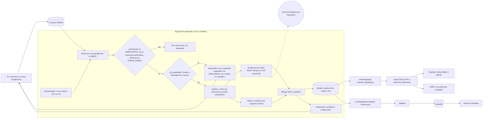
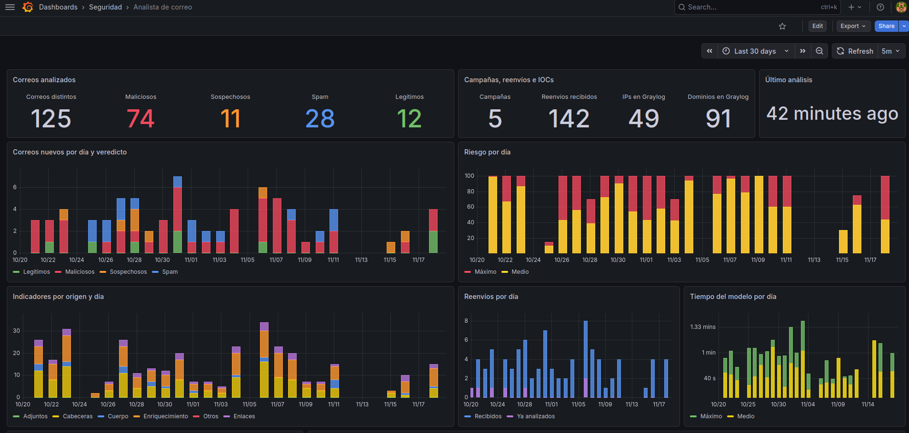

# suspicious-email-analyzer

[English](README.en.md) · **Castellano**

**Analizador local de correos sospechosos (phishing, fraude, malware, spam).** Reenvías un correo dudoso a un buzón
propio y recibes un JSON con la valoración de riesgo: indicadores técnicos deterministas (SPF/DKIM/DMARC, enlaces,
adjuntos analizados por dentro y sin ejecutarlos) más la opinión de un modelo local con Ollama (`qwen2.5:7b`). Nada
sale de tu equipo salvo el correo con tu proveedor y las consultas de enriquecimiento a servicios de reputación públicos, que puedes desactivar.

> **English version:** [README.en.md](README.en.md). El programa se llama `analista-correo` en el código, los nombres de fichero y la configuración; sus mensajes, reglas y campos JSON están en castellano.

## Cómo encajan las piezas



`contrib/despliegue/` monta el equipo del analizador (contenedor, Ollama, modelo y temporizador) con un comando; todo lo que queda a la derecha del analizador es opcional.

## Inicio rápido

Requisitos: Python 3.11+, [Ollama](https://ollama.com) con un modelo (`ollama pull qwen2.5:7b`; `qwen2.5:3b` si vas
justo de memoria; con más capacidad, uno mayor con `ANALISTA_CORREO_MODELO=qwen2.5:14b` o `--modelo` en `analizar_correo.py`), `dig` (paquete `dnsutils`/`bind-utils`, para el rDNS del enriquecimiento) y, para `pruebas/probar.sh`,
`jq`. Para el modo buzón, una cuenta de correo con IMAP y SMTP.

```
git clone https://github.com/k4y53r/suspicious-email-analyzer.git && cd suspicious-email-analyzer
python3 analizar_correo.py pruebas/sinteticos/malware-adjunto.eml      # un análisis, sin buzón
python3 -I pruebas/probar_reglas.py                                    # pruebas sin modelo ni red
```

Para el modo buzón:

```
mkdir -p ~/.config/analista-correo && cp buzon.env.example ~/.config/analista-correo/buzon.env
chmod 600 ~/.config/analista-correo/buzon.env      # y edítalo: servidor, usuario, MX_BUZON, REMITENTES
ANALISTA_CORREO_SIN_ENRIQUECER=1 python3 buzon.py --eml pruebas/sinteticos/legitimo-trabajo.eml   # sin IMAP/SMTP ni servicios externos: imprime la respuesta que enviaría (el modelo local sí hace falta)
```

Despliegue automático en un LXC de Proxmox (o en un Debian): [`contrib/despliegue/`](contrib/despliegue/README.md) (un comando; solo pones tu `buzon.env` y, si quieres, otro modelo de Ollama con `--modelo`). Para hacerlo a mano, programa `run.sh` en cron o en un timer de systemd (ver [Modo buzón](docs/mailbox-mode.md)). Para reenviar desde Thunderbird o Gmail,
`guia-reenvio.md`. Lo opcional (exportar IOCs a Graylog, métricas para Grafana) está en `contrib/`.

## Privacidad y límites

- El analizador no abre enlaces ni ejecuta adjuntos. El texto del correo llega al modelo local; el correo, los
  análisis y las respuestas quedan en `~/.local/state/analista-correo/` (700, ficheros 600).
- Un modelo de 7B se equivoca: trata el veredicto como una segunda opinión. Los correos pueden intentar manipular al
  modelo (inyección); por eso el texto oculto y las frases de inyección puntúan aparte y el modelo no puede rebajar los
  indicadores fuertes.
- Las consultas de enriquecimiento (abuse.ch, listas públicas, RDAP, OTX) envían a esos servicios IP y dominios del
  correo. En `analizar_correo.py` solo ocurren con `--enriquecer`; el modo buzón (`buzon.py`) las hace siempre salvo que
  pongas `ANALISTA_CORREO_SIN_ENRIQUECER=1` en el entorno de `run.sh`/cron.
- Seguridad: ver `SECURITY.md`. Licencia: AGPL-3.0-only (`LICENSE`), copyright © 2026 k4y53r: puedes usarlo, modificarlo y compartirlo, pero las versiones modificadas (también las ofrecidas como servicio en red) deben publicarse con la misma licencia.

## Fuentes de terceros y atribución

El enriquecimiento (opcional) usa servicios y listas públicas con sus propios términos de uso; revísalos antes de un uso intensivo: [abuse.ch](https://abuse.ch) (ThreatFox, URLhaus; exige una Auth-Key gratuita), la lista de salidas de [Tor](https://check.torproject.org/torbulkexitlist), [Feodo Tracker](https://feodotracker.abuse.ch/), [Spamhaus DROP](https://www.spamhaus.org/drop/) (condiciones de uso propias), el ranking [Tranco](https://tranco-list.eu) (cítalo si publicas resultados que lo usen), RDAP (registros públicos de cada RIR/registro) y, si lo configuras, AlienVault OTX.

## Uso

```
python3 analizar_correo.py correo.eml
python3 analizar_correo.py --reenviado reenviado.eml
python3 analizar_correo.py --sin-modelo correo.eml
python3 analizar_correo.py --modelo qwen2.5:3b correo.eml
python3 analizar_correo.py --enriquecer correo.eml      # listas públicas, abuse.ch y RDAP (y OTX si lo configuras)
```

Sin dependencias externas. Con el 7B en CPU tarda unos 15-55 s por correo con el modelo cargado y 40-75 s en frío (medido en CPU, sin GPU).

`pruebas/probar_reglas.py` (sin modelo ni red, segundos) comprueba frases de inyección, estilos ocultos y visibles y
HTML con etiquetas sin cerrar, tipos reales y adjuntos ZIP; pásalo tras tocar `INYECCION`, `CSS_OCULTO`, `Texto`,
`MAGIA`, `mirar_ole` o las reglas de adjuntos.

`pruebas/probar.sh [modelo] [salida.jsonl]` pasa `pruebas/corpus.tsv` (correos etiquetados con el veredicto esperado) y marca
si coincide. En el repo solo hay los sintéticos de `pruebas/sinteticos/` (dominios `*.example` o inventados, sin datos
personales); añade tus propios correos a `corpus.tsv` guardándolos **fuera de git**, porque los reales tienen datos
personales. Con modelo tarda ~1 min por correo (`PAUSA` segundos de descanso entre ellos, 60 por defecto).

## Elegir modelo

El modelo da una segunda opinión; los indicadores deterministas deciden la mayoría de los veredictos. Una comparación
sobre los 23 correos sintéticos de `pruebas/corpus.tsv` (mismo código, solo cambia `--modelo`; con enriquecimiento) da un
punto de referencia:

| Modelo | Dentro del veredicto esperado | Tiempo del modelo por correo (mediana / máx) | Corpus entero |
|---|---|---|---|
| `qwen2.5:7b` (por defecto) | 23 / 23 | 64 s / 143 s | 28 min |
| `qwen2.5:14b` | 22 / 23 | 145 s / 298 s | 59 min |

Medido en un Xeon E5-2620 v1 de 6 núcleos (solo AVX, DDR3-1067, sin GPU) con un contenedor de 10 vCPU y 28 GB de RAM; los
tiempos escalan con tu equipo y una GPU los cambia mucho.

- **Veredicto y riesgo distintos en 6 de 23 correos.** El 14b clasifica mejor los que el 7b llamaba «legítimos» siendo
  maliciosos (inyección con texto oculto, adjuntos con macros o cifrados, un cebo), pero el veredicto final casi no se
  movió, porque los indicadores técnicos ya acertaban.
- **El modelo mayor no es mejor sin más.** El 14b fue el único que falló: puntuó como malicioso (65) un cebo sin enlace
  donde el 7b dijo sospechoso (50), y lo esperado era cualquier cosa por debajo de malicioso.
- **Cuesta unas 2,3 veces el tiempo y el doble de memoria** (el 14b necesita ~9 GB libres además del sistema).
- Este corpus es sintético y está hecho para ejercitar las reglas, no para engañar al modelo. No es un ranking: es un
  punto de partida. Para comparar con tu correo, pasa `pruebas/probar.sh <modelo> salida.jsonl` una vez por modelo y
  compara los resultados; guarda tu corpus real **fuera de git**. Para cambiar: `--modelo` en `analizar_correo.py`, o
  `ANALISTA_CORREO_MODELO` (el temporizador, en `contrib/despliegue/README.md`).
- Regla práctica: empieza con el de por defecto; prueba uno mayor si te sobra memoria, tus correos dependen más del texto
  que de las cabeceras, o tienes GPU; usa `qwen2.5:3b` solo si vas justo de memoria (no medido aquí).

## Qué hacer con la salida

El analizador está pensado para alimentar las herramientas que ya tengas. Cada análisis deja cuatro tipos de salida: el
`analisis.json` adjunto a cada respuesta (veredicto, riesgo, indicadores e `iocs`), la base SQLite (`analisis.db`) y dos
exportaciones opcionales en `contrib/`: listas CSV de IPs y dominios maliciosos y métricas en line protocol de InfluxDB.

| Objetivo | Cómo | Dónde |
|---|---|---|
| Detectarlo en tu red (Graylog o cualquier SIEM) | Las listas CSV (`correo_iocs_ip.csv`, `correo_iocs_dominio.csv`) sirven de lookup table: alerta cuando un cliente de tu LAN resuelve o contacta una IP o un dominio que ya llegó por correo. | `contrib/README.md`, «Exportación de IOCs» |
| Panel (Grafana) | `metricas.py` escribe line protocol de InfluxDB y Telegraf lo recoge. Medidas: `correo_dia` (veredictos y riesgo medio por día), `correo_indicador` (qué lo disparó: cabeceras, cuerpo, adjuntos, URLs, enriquecimiento), `correo_envios` (reenvíos y análisis reutilizados), `correo_modelo` (latencia del modelo), `correo_autenticacion` (resultados de SPF/DKIM/DMARC), `correo_total` y `correo_campana` (campañas). Hay un panel importable en `contrib/grafana-telegraf/dashboard.json`. | `contrib/README.md`, «Métricas para Grafana» |
| Plataforma de inteligencia de amenazas (MISP) | Lee esas mismas listas CSV (o la tabla `iocs`) y crea un evento de MISP por campaña, con las IPs y dominios como atributos. En `contrib/README.md` hay un ejemplo corto con PyMISP. | `contrib/README.md`, «MISP» |
| Bloquear en el DNS (AdGuard Home, Pi-hole…) | Convierte el CSV de dominios en una lista de bloqueo. Revísala antes: es una muestra de lo que llegó a tu buzón, no un feed curado. | tu filtro DNS |
| Preguntas puntuales | Las consultas SQL de [Modo buzón](docs/mailbox-mode.md#base-de-datos-y-duplicados) (infraestructura compartida por ASN, campañas por dominio raíz, plantilla o kit). | `analisis.db` |


*El panel de `contrib/grafana-telegraf/dashboard.json`: totales por veredicto, correos nuevos por día, riesgo, indicadores por origen, reenvíos y latencia del modelo. Datos reales del buzón del autor.*


*Resultados de SPF/DKIM/DMARC y campañas (el mismo texto o enlace de alojamiento desde remitentes distintos).*

Qué conviene saber antes de automatizar encima:
- Las listas CSV solo llevan veredictos maliciosos, quitan la infraestructura compartida (webmail, acortadores,
  plataformas de envío), tus dominios y los populares del ranking Tranco, y limitan la edad de lo que exportan (90 días
  las IPs, 180 los dominios). Aun así son la opinión de un modelo sobre unos pocos correos: deja a una persona en el
  circuito antes de bloquear.
- Un enlace a alojamiento compartido es un IOC como URL completa, no como dominio; el exportador ya mantiene esa
  distinción.
- `info` en el CSV solo lleva datos propios (riesgo, campaña, fecha, número de correos), nunca el asunto ni el texto,
  porque los escribe el atacante.
- Da a cada integración sus propias credenciales con el mínimo privilegio (una clave de MISP solo Publisher, un token de
  InfluxDB solo de escritura) y guárdalas en ficheros con permisos 600, no en la línea de comandos.

## Documentación

El detalle está en `docs/` (cada página tiene versión en inglés y en castellano):
- [Cómo funciona](docs/how-it-works.md): qué comprueba el analizador, cómo se construye la puntuación, cómo reenviar un correo.
- [Modo buzón](docs/mailbox-mode.md): `buzon.py`, configuración, la base de datos, duplicados y consultas SQL útiles.
- [Enriquecimiento](docs/enrichment.md): consultas de reputación, pesos, OTX, abuse.ch, Tranco.
- [Reglas de detección de la 1.15](docs/detection-rules.md): la tabla R1-R7 y sus límites.
- [Despliegue automático](contrib/despliegue/README.md), [extras opcionales](contrib/README.md), [política de seguridad](SECURITY.md) y [guía de reenvío](guia-reenvio.md).
